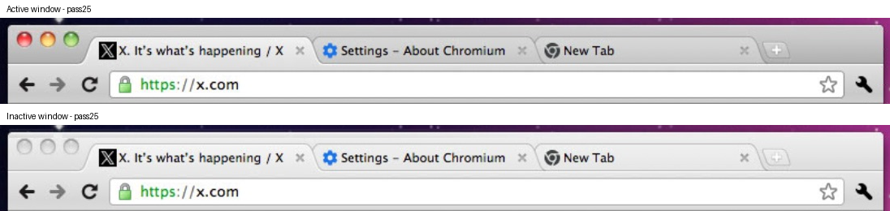
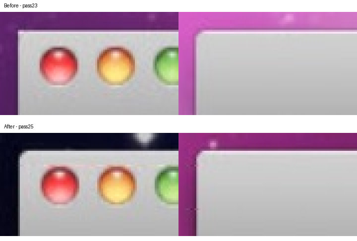
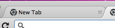
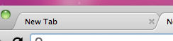
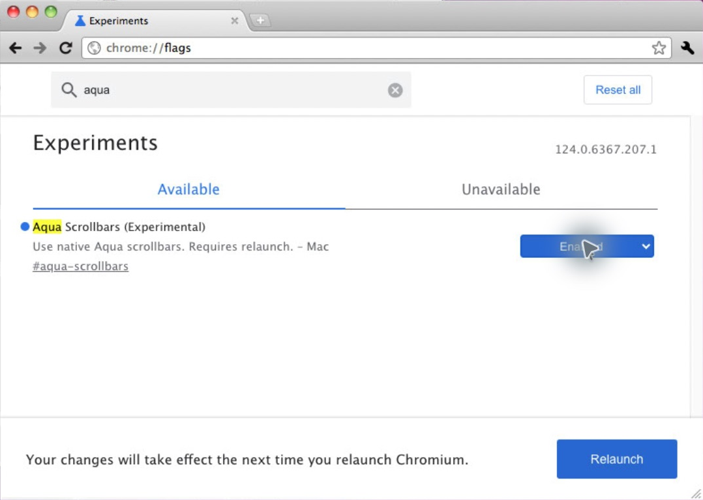
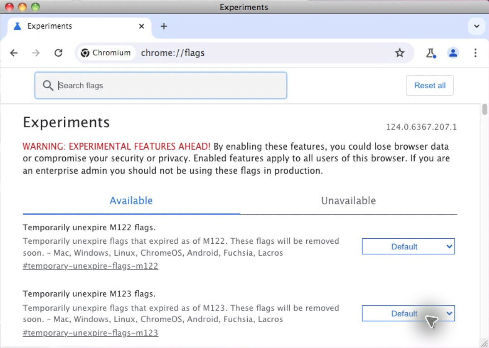
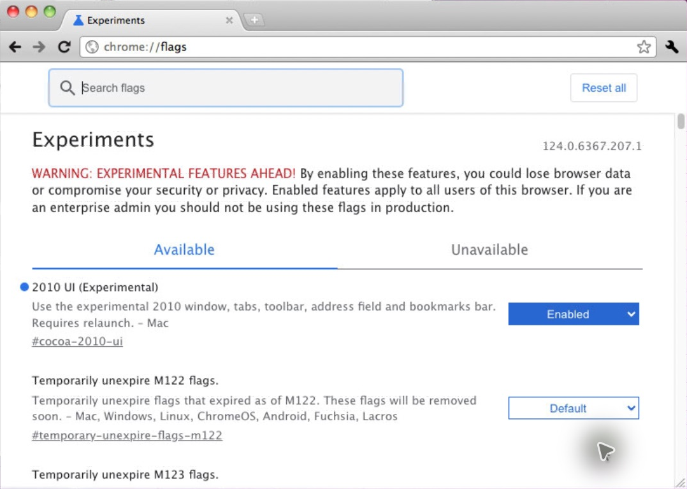
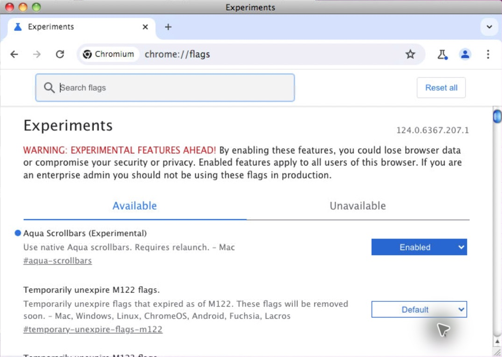
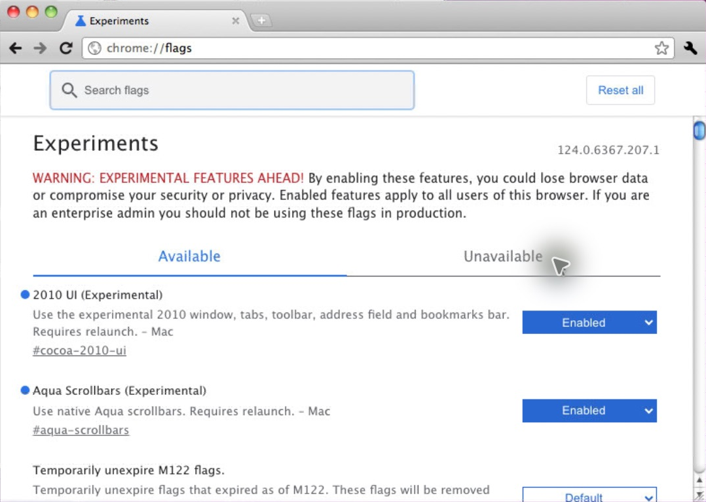

# Window appearance checks on OS X 10.6.8

The pass25 experimental build compiled successfully and was deployed to the task-owned development bundle and profile. No release package was produced.

Native Screen Sharing input exercised three application activation/deactivation cycles and two focus cycles between two windows of the experimental browser. Every observed state change repainted the selected and unselected tabs. The unselected-tab sample was consistently RGB 212.5 while active and 237.45 while inactive. The red traffic-light sample changed from RGB (253, 92, 97) to (222, 222, 222), independently confirming the window state. Selected-tab samples changed consistently as recorded in [state-samples.json](state-samples.json).

The square upper-left corner came from combining a reversed traffic-light rectangle with the rounded outer clip. Using separate intersecting clips exposes AppKit's native rounded frame at both corners. The right-hand corner is mirrored below to make the contours easier to compare; the crops are enlarged four times with nearest-neighbor sampling.

The screenshots are captures of the scaled Screen Sharing view, not native-pixel measurements. Color samples establish consistent state updates, not exact color parity with Chromium 7. The existing historical tab highlight drawing was preserved. The temporarily moved test window was returned to its original position, and the previously selected window was brought forward again.

## Full tab-strip window dragging

Chromium 7 attaches its 36pt tab strip to the native frame as a sibling of the content view. The strip is a plain transparent `NSView`, which allows native background dragging. Its tab hit test excludes the sloping edges using the original one-third-height inset; the new-tab button uses its four-point polygon instead of its whole rectangular bounds. The toolbar declines window dragging.

Chromium 124's opaque `BridgedContentView` covered the lower part of that strip. On Snow Leopard, AppKit asks `_opaqueRect` when calculating its server-side window-move exclusion region; the later `_opaqueRectForWindowMoveWhenInTitlebar` override is not used for this purpose on 10.6. The enabled native controller now sets the actual strip overlap as a move-only inset, leaving the toolbar and page excluded. The inset returns to zero during controller cleanup. With the 2010 UI disabled it stays zero and both methods retain their original behavior. Paint opacity is unchanged. The new-tab polygon is ported directly from the historical source.

A native drag near the bottom of empty strip space moved the pass31 window from `(672,180,788,561)` to `(723,216,788,561)` in target screen coordinates. A subsequent drag in the toolbar left it at `(723,216,788,561)`. These observations came from native Screen Sharing input and read-only `CGWindowListCopyWindowInfo` bounds. No manual window-move loop or synthetic AppKit event was used.

In the final pass32 build, drags in the page and from the new-tab button to outside its hit polygon both left the window at `(22,202,788,561)`. The latter also left the single Experiments tab intact, confirming that release outside the button did not activate it.

## Fine tab highlight

Both pinned 7.0.517.41 and the reference binary's 7.0.530.0 source draw the inner white highlight only on the selected tab with the default theme. The port retains the same copied path, (+1,-1) and (-2,0) translations, and one-point strokes. A fresh selected-tab capture in pass31 visibly contains the line along the top and curved sides:

The supplied 1:19:34 PM port crop appears to show the left tab unselected, while the 1:19:37 PM Chromium 7 crop shows it selected. That explains the apparent difference in the fine inner stroke; the exact selection state at capture has not been confirmed. No extra stroke was added to unselected tabs.

## Independent runtime preferences

Pass32 changes the 2010 UI default to disabled and adds the separately disabled-by-default Aqua feature. The task profile's existing 2010 UI Enabled preference remains intact. Aqua was enabled through the actual flags page, and read-only Local State inspection recorded `aqua-scrollbars@1` and `cocoa-2010-ui@1`.

All four combinations were exercised through native flags-page controls and relaunches on 10.6.8. Read-only flags DOM and Local State inspections confirmed the saved choices. Default is disabled for both preferences.

| 2010 UI | Aqua scrollbars | Observed result |
|---|---|---|
| Default | Default | Modern window, toolbar and in-app icons; grey modern scrollbars |
| Enabled | Default | Historical Cocoa window, toolbar and in-app icons; grey modern scrollbars |
| Default | Enabled | Modern window, toolbar and in-app icons; native blue Aqua scrollbars |
| Enabled | Enabled | Historical Cocoa core UI and native blue Aqua scrollbars |

With the core UI disabled, native address-field input also opened the existing Views autocomplete popup. The historical editor, popup, URL elision changes, native frame/layout, toolbar, tabs, bookmarks bar and in-app artwork all require the core UI flag or an adapter session created by that flag. The new move-only frame inset is zero by default and resets on controller cleanup. Aqua painting, geometry, invalidation and resize-corner reservation require the independent disabled-by-default `AquaScrollbar` feature. Renderer processes receive it through Chromium's standard feature propagation. No forced-main-thread scrolling is present.

The application icon is the deliberate exception: the original Chromium 7 `app.icns` is a static bundle resource in both modes. Its SHA-256 in the final build matches the retained original: `aec07ce512c60270ba2bedf33a37bcbfcd5d6ae02effc03397b3bf92bd23eebe`.

The final pass32 build compiled successfully and was copied into the isolated task bundle. Both experimental preferences were restored to Enabled. Source/overlay agreement, forward and reverse patch checks, repeated installer runs and repository integrity checks passed. No release package was produced. Aqua refresh delay during long main-thread tasks remains unresolved, as documented in the scrolling benchmarks.

## New-tab image alignment

The supplied 5:33:25 PM screenshot exposed a half-point vertical offset. The original Mac PDF is 30×26 points, while the button's hit frame is 40×27. Arithmetic centering placed the image at `(5,0.5)`, filtering its fine edges across adjacent rows. Chromium 7 lets its native `NSButtonCell` place the image. Decoding the original BrowserWindow.xib cell flags and asking the actual 10.6.8 cell for `imageRectForBounds:` returned `(5,1,30,26)` with `NSImageScaleNone`. The corrected port cell returns that same rectangle.

Pass33 uses the native cell's image rectangle and natural-size setting for the original normal, hover and pressed PDFs. The artwork and polygon hit mask are unchanged. The build and repeated installer check passed, and native input in the updated task browser opened a tab successfully. These before/after crops were captured with Screen Sharing at Actual Size, which produces two host screenshot pixels per target point on the Retina host; they are visual comparison evidence rather than direct framebuffer color measurements.

Before:

After:

## Tab foreground on mouse down

The tab set its `dragging` state before activating Chromium's tab model. The synchronous selection snapshot changed its appearance, but `layoutTabs:` returned early while tracking, leaving the previous tab above it until mouse up. Chromium 7 fires its selection action before capturing the tab's frame and starting drag tracking. Pass34 restores that order and calls `displayIfNeeded` and `CATransaction flush` before waiting for the next event.

Native Screen Sharing input reproduced the old mismatch: the third tab became selected, but the second tab's right slope remained above it until release. A capture during the corrected short press shows the newly selected second tab above its third-tab neighbor, with the same stacking after release. The test selections differ because remote drag positioning initially acted from the previous pointer location; positioning the pointer over the inactive tab before pressing avoided that transport issue. These crops establish the selection/stacking behavior, not pixel or timing parity with Chromium 7.

The pass34 build compiled and was deployed to the isolated task app with both saved UI preferences enabled. The fix stays within the flag-gated Cocoa tab class.
